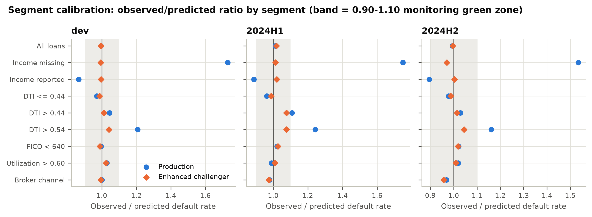
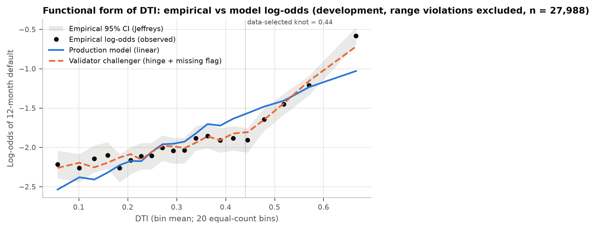
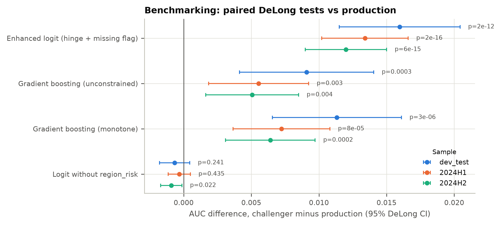
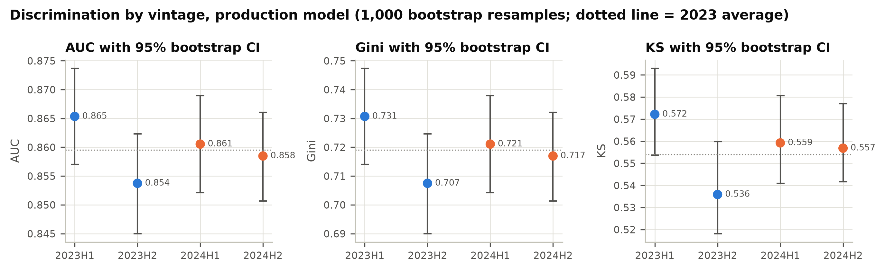

# Independent Validation of a Consumer PD Model (SR 26-2 / OCC 2026-13)

This repository is an end-to-end, second-line **independent model validation** of a retail credit
probability-of-default (PD) model. It applies SR 26-2, "Revised Guidance on Model Risk Management"
(Federal Reserve, April 17, 2026; OCC Bulletin 2026-13; FDIC FIL-15-2026). SR 26-2 superseded
SR 11-7 / OCC 2011-12 and retains its three validation components: conceptual soundness, outcomes
analysis and ongoing monitoring. It is written the way a bank Model Risk Management (MRM)
function would write it. It contains:

- a frozen first-line "production" model;
- a validation library with independently implemented statistics, tested against closed-form results;
- a one-command pipeline that writes every result to `outputs/`;
- a 21-page validation report (`report/validation_report.pdf` / `.docx` / `.md`) with an overall rating, a findings register and conditions for use. Every number in the report is inserted from `outputs/`.

> **The data are synthetic.** `data/make_data.py` generates 54,000 loans from a fully documented
> data-generating process (DGP) with deliberately planted weaknesses. This is a feature, not a
> shortcut. Because the true process is known, every finding can be traced to its cause, and the
> reader can check that the validation found what it should have found and nothing it should not.
> The pipeline is data-agnostic (see *Using real data* below).

## What the validation found

**Overall rating: Fit with Conditions.** The model rank-orders risk well, and it stays accurate in
aggregate out of time. Behind the aggregate numbers are two segment-level errors with identified
causes.

| Area | Result |
|---|---|
| Discrimination | AUC 0.8596 on development; 0.8605 [0.8521, 0.8689] on 2024H1 and 0.8585 [0.8506, 0.8660] on 2024H2 (1,000-resample bootstrap CIs). No out-of-time decay. |
| Aggregate calibration | Hosmer-Lemeshow p = 0.326 / 0.812 / 0.086 (dev / 2024H1 / 2024H2); all 16 out-of-time grade-level Jeffreys tests green. |
| **F-01 High** | Income-missing borrowers under-predicted: observed/predicted (O/P) 1.73 / 1.75 / 1.53. The cause is median imputation with no missing indicator. |
| **F-02 High** | DTI enters linearly, but a profile-likelihood search finds a hinge at 0.44 (95% CI 0.42 to 0.47). The top DTI decile (DTI > 0.54) is under-predicted (O/P 1.21 / 1.24 / 1.16). |
| Benchmarking | A two-term fix (missing flag + DTI hinge) beats production by +0.0134 / +0.0120 AUC out of time (DeLong p < 0.0001). It also beats an unconstrained GBM, so the gap is in the specification, not the method. |
| Stability | 2024H2 score PSI 0.194 (amber), driven by FICO and utilization. Calibration held because this is covariate shift, not concept drift. |
| Fair lending | AIR 0.938 to 0.956 (passes the 4/5 rule). `region_risk` is a partial proxy (corr 0.348). Removing it raises AIR to 0.981 for 0.0009 AUC, but leaves the protected group under-predicted. The trade-off needs a documented LDA decision. |

The full findings register (2 High, 4 Medium, 2 Low) is in Section 11 of the report.

| | |
|:---:|:---:|
|  |  |
| *Aggregate calibration hides offsetting segment errors* | *Linear DTI misses the change in slope at the data-selected knot (0.44)* |
|  |  |
| *Paired DeLong tests: specification gap, not methodology gap* | *Discrimination by vintage with bootstrap CIs* |

## How this maps to SR 26-2 / OCC 2026-13

| SR 26-2 element | Where it is demonstrated | Code |
|---|---|---|
| Conceptual soundness: methodology, variable selection, documentation | Report §4: Wald table, sign/VIF checks, WOE/IV, binned-logit functional form, profile-likelihood DTI knot search, documentation gap review | `validation/tests.py::conceptual_checks`, `advanced.py::woe_iv_all`, `binned_logit_profile` |
| Conceptual soundness: data quality | Report §3: missingness, informative missingness test, range edits | `tests.py::data_quality` |
| Replication | Report §4.2: re-fit from documented recipe; reported AUCs reproduced to 5e-5 | `tests.py::replicate`, `advanced.py::replicate_reported` |
| Outcomes analysis: discrimination | Report §5.1: AUC / Gini / KS with bootstrap CIs, per vintage | `stats_core.py::bootstrap_discrimination` |
| Outcomes analysis: calibration | Report §5.2 to 5.4: CITL, Spiegelhalter, HL, slope, ECE, master-scale Jeffreys traffic lights, segment calibration | `advanced.py::calibration_suite`, `grade_backtest`, `segment_calibration` |
| Conceptual soundness: benchmarking (a listed assessment alternative) | Report §6: four challengers, paired DeLong tests | `advanced.py::benchmark_delong` |
| Sensitivity / stress | Report §7: OAT elasticities, Sobol indices, covariance-consistent coefficient perturbation, missing-income counterfactual | `advanced.py::elasticity_table`, `sobol_indices`, `coefficient_perturbation` |
| Ongoing monitoring | Report §8: PSI/CSI, grade-mix migration, 13-KPI plan with thresholds and escalation | `outputs/monitoring_thresholds.json` |
| Effective challenge (objective experts with standing to effect change) | Independent estimators, challengers, findings register with owners and dates | whole repository |
| Fair lending (bank policy; ECOA/Reg B) | Report §9: AIR, DP/EO/FPR gaps, proxy LR tests, LDA trade-off | `advanced.py::fairness_extended`, `proxy_and_marginal_effect` |
| Non-generative AI/ML (in scope of SR 26-2) | Report §10: importance stability, monotonicity (PD/ICE), adverse-action implications | `advanced.py::importance_stability`, `monotonicity_check` |


## Project structure

```
data/
  make_data.py            synthetic portfolio, documented DGP and planted weaknesses
  loader.py               load + dev/OOT split (swap point for real data)
model/
  develop_model.py        FIRST LINE: production logistic PD model (treated as frozen)
  pd_model_v1.pkl         frozen artifact
  developer_documentation.json
validation/               SECOND LINE
  stats_core.py           AUC/KS/DeLong/bootstrap, HL/Spiegelhalter/CITL/Jeffreys, PSI, AIR, IRLS logit, WOE/IV
  tests.py                baseline tests: data quality, replication, conceptual, outcomes, stability, fairness
  advanced.py             CIs, DeLong, master scale & traffic lights, segments, sensitivity, Sobol,
                          fairness extensions, ML-challenger checks, monitoring plan
  figures.py              consistent 300-dpi figure style
  run_validation.py       orchestration: writes outputs/
tests/test_stats.py       24 unit tests against closed-form / reference values (incl. knot recovery)
report/
  template.md             report text with {{placeholders}}
  build_report.py         fills placeholders from outputs/, checks finding triggers, builds DOCX/PDF
  validation_report.{md,docx,pdf}
outputs/
  tables/*.json|csv       every number cited in the report
  figures/*.png           21 figures
  monitoring_thresholds.json
  run_manifest.json       seeds, library versions, SHA-256 of inputs
```

## How to run

```bash
pip install -r requirements.txt      # numpy, pandas, scipy, scikit-learn, matplotlib, pytest
make all                             # data -> model -> validate -> test -> report  (about 3 minutes)
```

Individual targets: `make data`, `make model`, `make validate`, `make test`, `make report`.
The report build needs `pandoc` and `wkhtmltopdf`; LibreOffice is used as a PDF fallback.
All randomness is seeded. Two runs on one machine produce identical tables and figures; across machines the results agree to the precision printed in the report (binary artifacts such as the pickled model can differ in the last floating-point bits, so their content hashes differ).

The report builder works in two steps:

1. It re-tests the evidence behind every finding (`check_finding_triggers`). For example, it checks that "income-missing O/P > 1.3 and significant on every sample" still holds.
2. It renders the report only if every check passes.

If new data changes the evidence, the build fails. It never publishes a register that contradicts the numbers.

## Using real data

Only `data/loader.py` needs to change. `load_portfolio()` must return one row per loan with:
`loan_id`, `vintage`, `default_12m` (0/1), the model inputs used in `model/develop_model.py::prepare`
(`fico`, `dti`, `utilization`, `income`, `inquiries_6m`, `delinq_24m`, `employment_years`,
`region_risk`, `channel`), and a group label for fair-lending tests (`protected_class`). In practice
that label is a BISG-style proxy. Set `DEV_VINTAGES` and `OOT_VINTAGES` to your time periods.

- **Lending Club**: target from `loan_status` (charged off / default within 12 months of `issue_d`), vintage from `issue_d`, `fico_range_low`, `dti`/100, `revol_util`/100, `annual_inc`, `inq_last_6mths`, `delinq_2yrs`, `emp_length`. Lending Club has no zip-level risk index; use a 3-digit-zip default-rate encoding fit on development data only.
- **Home Credit Default Risk**: `TARGET` as default, external scores `EXT_SOURCE_*` in place of FICO, `AMT_ANNUITY / AMT_INCOME_TOTAL` as a DTI analogue. The application table has no origination date, so a true out-of-time split is not available. Use a documented pseudo-vintage split, and record the absence of OOT testing as a validation limitation.

Then run `make model validate test`. The report template's narrative is written for the synthetic
findings. With real data, the trigger check tells you which findings to rewrite.

## Notes on method choices

- **Machine-independent fits.** Every logistic regression is fitted with the Newton-Cholesky solver at a tight tolerance (`tol=1e-10`). scikit-learn's default L-BFGS solver stops short of the optimum on these unscaled inputs, and where it stops depends on the machine's linear-algebra library, so coefficients would differ between machines.
- **Independence.** The validator's estimators (IRLS logit, DeLong, Jeffreys, Spiegelhalter, PSI, KS) are written from first principles and unit-tested against closed forms. The validation does not rely on the developer's library calls.
- **Covariance-consistent perturbation.** Shifting one uncentred coefficient by ±1 SE produces coefficient vectors the data rule out (intercept/`income_log` correlation −0.87). The report shows both the naive and the conditional versions, plus a joint Monte-Carlo draw.
- **Grade migration.** Origination data have no repeat observations of an obligor. The report therefore gives grade-mix migration and a production-vs-challenger reclassification matrix instead of inventing an obligor transition matrix.
- **Fair-lending tests** use a simulated, directly observed class label. Real programs use proxies such as BISG, which add measurement error. The report states this limitation.
