

# Independent Model Validation Report

## Consumer PD Model v1.0 (CR-PD-0142)

| | |
|:---|:---|
| **Model name** | Consumer PD Model v1.0: 12-month probability of default, unsecured consumer loans |
| **Model ID** | CR-PD-0142 |
| **Model owner (first line)** | Retail Credit Analytics |
| **Model use** | Underwriting approve/decline cut-off; risk-based pricing |
| **Model tier** | Tier 1 (highest materiality band) |
| **Standard applied** | SR 26-2 / OCC Bulletin 2026-13, Revised Guidance on Model Risk Management (April 17, 2026); bank Model Risk Management Policy |
| **Validation type** | Initial full-scope validation (model in production without prior independent validation) |
| **Validator** | Model Risk Management, Retail Credit Model Validation (second line) |
| **Validation period** | 2026-09-14 to 2026-11-06 |
| **Report date** | 2026-11-09 |
| **Next scheduled review** | Full revalidation on redevelopment, no later than 2027-06-30; annual review thereafter |
| **Overall rating** | **FIT WITH CONDITIONS** |

**Data notice.** The portfolio analysed in this report is synthetic. It was generated from a fully documented data-generating process (`data/make_data.py`) with known weaknesses, so that each finding can be traced to its cause. The validation code is data-agnostic and runs unchanged on a real portfolio. Model ID, owners, dates and policy references are illustrative.

## 1. Executive summary

**Overall rating: Fit with Conditions.** Consumer PD Model v1.0 rank-orders risk well and is accurate for the portfolio in aggregate. It may stay in use for underwriting and pricing, subject to the conditions in Section 1.3. The model's average accuracy hides two material segment-level errors. The model owner must remediate both through a time-bound redevelopment.

The validation used 54,000 loans across four half-year vintages. These comprised the development sample (2023H1 to 2023H2, 28,000 loans) and two out-of-time (OOT) vintages that the developer never tested (2024H1, 14,000 loans; 2024H2, 12,000 loans). The validator reproduced the developer's results exactly before testing the model.

### 1.1 Key findings

- **Discrimination is strong and stable out of time.** AUC was 0.8596 [0.8539, 0.8664] on development, 0.8605 [0.8521, 0.8689] on 2024H1 and 0.8585 [0.8506, 0.8660] on 2024H2 (95% bootstrap CIs). All three intervals overlap. KS was 0.5529, 0.5592 and 0.5568 (Figure 7).
- **Aggregate calibration passes every test, and all 16 OOT grade-level backtests are green.** The observed-to-predicted (O/P) default ratio was 1.012 on 2024H1 and 0.994 on 2024H2. Hosmer-Lemeshow p-values were 0.240 (development), 0.824 (2024H1) and 0.102 (2024H2) (Table 5, Figures 8 and 9).
- **High (F-01): for borrowers with missing income, predicted PD is 35% to 43% below the observed default rate.** These borrowers are 10.7% of development loans. Their observed default rate was 45.0% in 2024H2 against a predicted 29.3% (O/P 1.53). The O/P ratio was 1.73 on development and 1.75 on 2024H1. The cause is median imputation with no missing-value indicator. Borrowers who report income are over-predicted (O/P 0.87 to 0.89 across the three samples), so the two errors offset in aggregate (Figures 10 and 14).
- **High (F-02): DTI enters the model linearly, but its effect on default is non-linear.** As a result, high-DTI borrowers are under-predicted. In the top DTI decile (DTI > 0.54; 10.3% of 2024H2 loans), O/P was 1.21, 1.24 and 1.16 on the three samples (each p < 0.0001). A challenger that adds a DTI hinge and a missing-income flag beat production on both OOT vintages: AUC +0.0134 on 2024H1 and +0.0120 on 2024H2, DeLong p < 0.0001 (Figures 2, 3 and 11).
- **Medium (F-03): the 2024H2 population shifted materially.** Score PSI reached 0.1936 (amber), driven by FICO (CSI 0.1498) and utilization (CSI 0.1785). Calibration held because the shift stayed inside the range the model was built on. However, the developer's "annual review" does not meet the standard for an ongoing monitoring plan.
- **Medium (F-04): `region_risk` partly proxies for the protected class, and no fair-lending review was documented.** Its correlation with the class is 0.348. The adverse impact ratio (AIR) of 0.939 on 2024H2 passes the four-fifths threshold. Removing the variable raises AIR to 0.981 at an AUC cost of 0.0009. That cost is small but statistically significant on 2024H2.
- **Other findings.** F-05 (Medium): no input range edits. F-06 (Medium): developer documentation incomplete. F-07 (Low): `income_log` is insignificant. F-08 (Low): early calibration drift in 2024H2. See the findings register (Section 11).

### 1.2 Use restrictions

1. Until F-01 is remediated, no PD for an income-missing applicant may be used for pricing or cut-off decisions without the interim overlay in Condition 1.
2. The model must not be applied to products or channels outside unsecured consumer instalment lending. Examples are secured lending and small-business borrowers.
3. Any applicant record that fails the range edits in Condition 3 must be referred for manual review. The model must not decline it automatically.

### 1.3 Conditions for use and required remediation

| # | Condition / remediation | Finding | Owner | Deadline |
|:--|:------------------------------------------------|:--------|:-------------|:--------|
| 1 | Apply an interim PD overlay to income-missing applicants. The validator's indicative pooled O/P multiplier is 1.67. The owner must calibrate and document the final overlay, and MRM must review it. | F-01 | Head of Retail Credit Analytics | 2026-12-11 |
| 2 | Redevelop the model with a missing-income indicator and a non-linear DTI term (or equivalent). Submit it for validation. | F-01, F-02, F-07 | Head of Retail Credit Analytics | 2027-03-31 |
| 3 | Implement input range edits (FICO 300 to 850, DTI 0 to 1) in the decision engine, with referral on failure. | F-05 | Retail Credit Technology | 2026-12-31 |
| 4 | Adopt the monitoring plan in `outputs/monitoring_thresholds.json`, including segment KPIs. The first quarterly pack is due by the deadline shown. | F-03, F-08 | Retail Credit Analytics | 2027-01-31 |
| 5 | Complete a fair-lending review of `region_risk`, including a documented less-discriminatory-alternative (LDA) decision. | F-04 | Fair Lending Compliance | 2027-01-31 |
| 6 | Bring the development documentation up to the bank's Model Documentation Standard. | F-06 | Retail Credit Analytics | 2027-03-31 |

If Condition 1 or 3 is missed, the rating becomes **Restricted Use** and the matter goes to the Model Risk Committee.

## 2. Scope, model description and intended use

### 2.1 Model description

Consumer PD Model v1.0 is an unpenalised logistic regression. It estimates the 12-month probability of default for unsecured consumer instalment loans at origination. It uses nine inputs: FICO, debt-to-income (DTI), revolving utilization, log income, inquiries in the last six months, delinquencies in the last 24 months, years in employment, a zip-level `region_risk` index and a broker-channel flag. Missing income is filled with the development-sample median ($60,294), and no missing-value indicator is used. The developer fit the model on a 70/30 random split of the 2023 vintages (19,440 training and 8,560 test loans). The developer reported train and test AUCs of 0.8632 and 0.8513. No out-of-time testing, sensitivity analysis or fair-lending review was performed. The monitoring plan was stated as "annual review".

### 2.2 Intended use and materiality

SR 26-2 states that model purpose, together with model exposure, determines model materiality.

- **Purpose.** The model makes automated underwriting decisions: it sets the approve/decline cut-off, and the policy approves the lowest-risk 70% of applicants (PD ≤ 14.56% at development). It also sets risk-based pricing tiers, and it drives adverse-action decisions under ECOA/Regulation B. A model error therefore changes credit losses, the price each customer pays and the bank's compliance with consumer-protection law.
- **Exposure.** Every applicant for an unsecured consumer instalment loan is scored. The four vintages reviewed contain 54,000 booked loans.

High-consequence purpose combined with portfolio-wide exposure places the model in the bank's highest materiality band (**Tier 1**). SR 26-2 states that higher-materiality models "warrant more comprehensive and rigorous oversight". Under the bank's policy, that means three things: a full-scope independent validation covering all three validation components, quarterly threshold-based monitoring, and an annual review.

### 2.3 Scope and approach

**Standard applied.** The validation applied SR 26-2, "Revised Guidance on Model Risk Management" (Federal Reserve, April 17, 2026). That guidance was issued jointly as OCC Bulletin 2026-13 and FDIC FIL-15-2026. It also applied the bank's Model Risk Management Policy and Model Validation Standard. SR 26-2 superseded SR 11-7 / OCC 2011-12 (April 4, 2011). It retains its predecessor's three validation components:

- conceptual soundness, with benchmarking listed as a practical assessment alternative;
- outcomes analysis;
- ongoing monitoring.

This validation covered all three. It also covered sensitivity analysis and fair lending, which the bank's policy requires. SR 26-2 does not set enforceable standards. The bank's policy makes these requirements binding internally. SR 26-2 also states that the quality of validation depends on the rigor and effectiveness of the review rather than the organizational structure of the risk function. The evidence in Sections 3 to 10 is presented so that its rigor can be judged directly.

The validator treated the model as a frozen artifact (`model/pd_model_v1.pkl`) and did not change it. All tests used the validator's own code base. That code includes independently written estimators: an IRLS logistic fit, DeLong, Jeffreys and Spiegelhalter tests, and PSI. Each estimator is unit-tested against closed-form results (`tests/test_stats.py`, 24 tests). Challenger models were fit on the developer's own training split, so every comparison is like-for-like. All results are reproducible from a single command (`make all`); see Appendix E.

## 3. Data review

**Table 1. Portfolio composition by vintage**

| Vintage | Role | Loans | Default rate | Mean FICO | Mean utilization | Income missing | FICO < 300 | DTI > 1 |
| :--- | :--- | ---: | ---: | ---: | ---: | ---: | ---: | ---: |
| 2023H1 | Development | 14,000 | 14.0% | 705.1 | 0.332 | 11.0% | 3 | 3 |
| 2023H2 | Development | 14,000 | 13.6% | 704.9 | 0.333 | 10.4% | 2 | 4 |
| 2024H1 | Out-of-time | 14,000 | 14.4% | 704.4 | 0.331 | 10.2% | 2 | 5 |
| 2024H2 | Out-of-time | 12,000 | 22.2% | 682.2 | 0.415 | 11.8% | 3 | 3 |

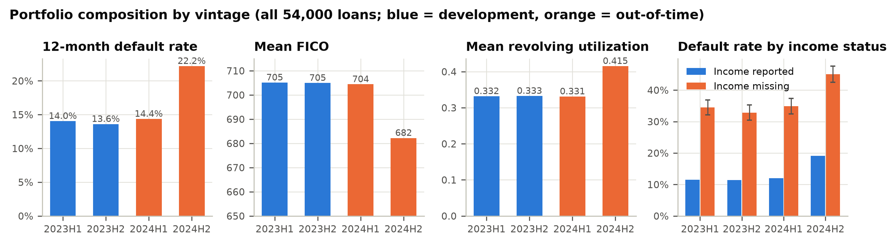{width=100%}

**Completeness.** Income was the only field with missing values: 10.83% of all loans, between 10.2% and 11.8% per vintage. The missingness is informative. Borrowers with missing income defaulted at 36.7%, against 13.3% for borrowers who reported income (chi-square p < 0.0001; Figure 1, right panel). A median fill without an indicator discards this signal. Sections 4 and 5 and finding F-01 address the consequences.

**Validity.** Range edits found 25 invalid records (0.046% of the portfolio): 10 with FICO = 0 and 15 with DTI > 1. These errors occur in every vintage. 8 of them were in the developer's training sample. The production model scores the FICO = 0 records at a mean PD of 1.0000 and the DTI > 1 records at 0.937. These applicants would be declined automatically on erroneous data. Neither the development code nor the documentation contains input edits (F-05). The records are too few to bias the coefficients materially. The control gap is the issue. The 12 development loans that fail range edits are excluded from analyses that fit or profile relationships (27,988 loans): functional-form plots, knot search, sensitivity and Sobol analysis, coefficient perturbation and the proxy tests. All discrimination, calibration, stability and fair-lending tests use the full 28,000 development loans, because the production model scores every applicant. WOE/IV and the challenger fits also use all rows, matching the developer's recipe.

**Population.** The 2024H2 vintage differs from development. Mean FICO fell from 705.0 to 682.2, mean utilization rose from 0.332 to 0.415, and the default rate rose to 22.2%. The other inputs did not move (Section 8). 2024H1 closely matches development (score PSI 0.0014). No duplicate loan IDs were found.

## 4. Conceptual soundness

### 4.1 Methodology

Logistic regression is the industry-standard method for application PD and is appropriate for this use. It is transparent and stable. It also produces the reason codes that adverse-action notices require. The validator does not object to the method. The objections concern two specification choices: the treatment of missing income and the functional form of DTI. It also objects to the absence of out-of-time evidence.

### 4.2 Replication

The validator re-ran the developer's documented recipe independently. The recipe covered the split seed, median imputation and estimator. The largest coefficient difference from the frozen artifact was 0.0e+00, and the largest score difference was 0.0e+00. Scoring the frozen artifact reproduced the reported AUCs: train 0.863186 (reported 0.8632; difference 1.4e-05) and test 0.851271 (reported 0.8513; difference 2.9e-05). The pre-set tolerance was half a unit in the fourth decimal place (5e-5). Both values passed, as did the sample counts. **Replication passed.** The model in production is the model that was documented.

### 4.3 Coefficients, signs and collinearity

**Table 2. Production coefficients with Wald statistics (information matrix on the developer's training split)**

| Variable | Coefficient | Std. error | z | p-value | Sign | VIF |
| :--- | ---: | ---: | ---: | ---: | ---: | ---: |
| intercept | 14.79593 | 0.74276 | 19.92 | < 0.0001 | n/a | n/a |
| fico | -0.02731 | 0.00056 | -48.95 | < 0.0001 | As expected | 1.000 |
| dti | 3.51527 | 0.15147 | 23.21 | < 0.0001 | As expected | 1.000 |
| utilization | 2.37781 | 0.13420 | 17.72 | < 0.0001 | As expected | 1.001 |
| income_log | -0.05558 | 0.05893 | -0.94 | 0.346 | As expected | 1.000 |
| inquiries_6m | 0.22539 | 0.02134 | 10.56 | < 0.0001 | As expected | 1.000 |
| delinq_24m | 0.52177 | 0.04470 | 11.67 | < 0.0001 | As expected | 1.000 |
| employment_years | -0.03953 | 0.00609 | -6.49 | < 0.0001 | As expected | 1.000 |
| region_risk | 0.50676 | 0.09704 | 5.22 | < 0.0001 | As expected | 1.000 |
| channel_broker | 0.37350 | 0.06403 | 5.83 | < 0.0001 | As expected | 1.000 |

All nine signs match economic expectation. 8 of the nine inputs are significant at the 1% level. The exception is `income_log` (z = -0.94, p = 0.346, F-07). All variance inflation factors are at most 1.001, so collinearity is negligible. The intercept (14.796) is large because the inputs are not centred. The intercept is strongly correlated with the FICO and income coefficients (correlations -0.47 and -0.87). Section 7.2 shows why this matters for sensitivity testing.

### 4.4 Characteristic analysis (WOE / IV)

**Table 3. Information value on development data**

| Characteristic | IV | Strength | Bins |
| :--- | ---: | ---: | ---: |
| fico | 1.539 | strong | 10 |
| income (raw, missing as bin) | 0.247 | medium | 11 |
| dti | 0.180 | medium | 10 |
| income_log (as imputed by model) | 0.176 | medium | 10 |
| utilization | 0.113 | medium | 10 |
| delinq_24m | 0.039 | weak | 4 |
| inquiries_6m | 0.036 | weak | 5 |
| employment_years | 0.018 | unpredictive | 10 |
| channel | 0.015 | unpredictive | 3 |
| region_risk | 0.014 | unpredictive | 10 |

FICO dominates (IV 1.539). Raw income with missing values as their own bin has IV 0.247, and **83% of that comes from the missing bin alone** (Figure 5). The model actually sees median-imputed `income_log`, which has IV 0.176. That value is also inflated, because the imputed median bin collects the high-risk missing records. The linear coefficient cannot use this signal. Income therefore matters to default only through its missingness, and the model specification discards exactly that information. `region_risk` has a low standalone IV (0.014). It is still significant in the multivariate model and is examined in Section 9.

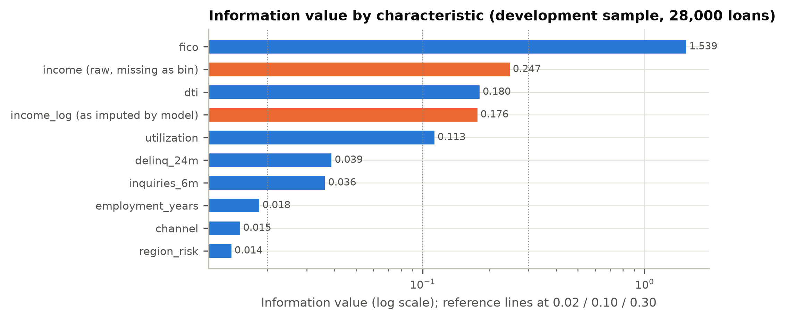{width=78%}

### 4.5 Functional form

Binned empirical log-odds were compared with the model's predicted log-odds across 20 equal-count bins (Figures 2 and 4). FICO is well described by a linear term. DTI is not. Empirical log-odds are flat up to about 0.44 and then rise steeply. The linear term over-predicts the middle of the range: at DTI ≈ 0.445, predicted PD is 17.3% against an observed 12.9%. It under-predicts the top bin: at DTI ≈ 0.666, predicted PD is 26.3% against an observed 35.8%. Above 0.44, the mean residual relative to the low-DTI linear trend is +0.365 on the logit scale. When a hinge at the data-selected knot is added, its coefficient is 5.18, and the linear DTI coefficient falls from 3.52 to 1.74. The validator's challenger tracks the empirical curve within its confidence band (F-02).

**Knot estimation.** The validator estimated the hinge location from the data rather than assuming it. A profile-likelihood search fitted the enhanced specification (nine production inputs, an income-missing flag and max(DTI − k, 0)) for every k from 0.20 to 0.65 in steps of 0.01. The fits used the developer's training split (19,432 loans that pass range edits). The log-likelihood peaks at **k = 0.44**, with a 95% profile-likelihood interval of [0.42, 0.47] (Figure 3). Relative to a linear-DTI specification, the hinge raises twice the log-likelihood by 124.9. The knot was selected from the same data, so this statistic is descriptive and not a formal chi-square test. The selected knot defines the challenger's hinge, the DTI segment ("DTI > 0.44") and the corresponding monitoring KPI. The high-DTI tail segment ("DTI > 0.54") is the top decile of development DTI.

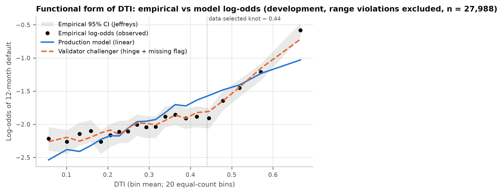{width=88%}

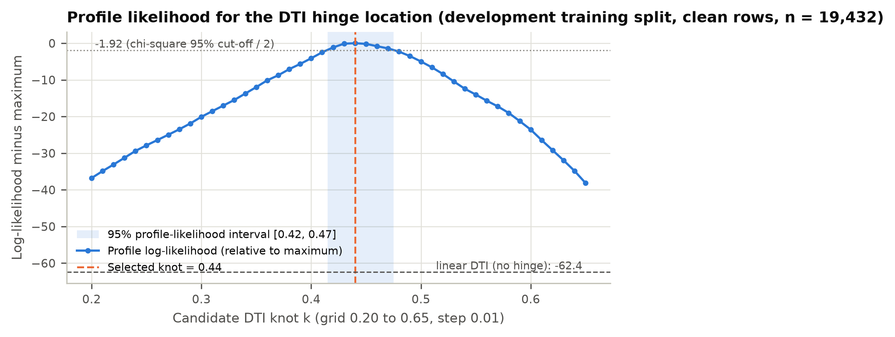{width=88%}

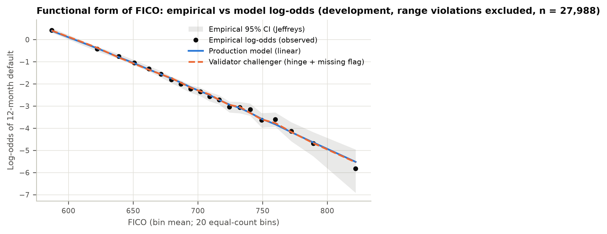{width=88%}

### 4.6 Documentation quality

The developer documentation (`model/developer_documentation.json`) records the purpose, sample, coefficients, imputation and train/test AUC. It lacks the following elements, which the bank's documentation standard requires for a Tier 1 model (F-06):

- assumptions and limitations;
- a justification for each variable, including `region_risk` and `income_log`;
- an analysis of alternative specifications;
- out-of-time testing;
- calibration testing beyond AUC;
- sensitivity analysis;
- a fair-lending review;
- an implementation and input-control description;
- a monitoring plan with thresholds.

The documentation was sufficient to replicate the model exactly. It was not sufficient for a reviewer to judge whether the model is fit for purpose.

## 5. Outcomes analysis

### 5.1 Discrimination

**Table 4. Discrimination with 95% bootstrap confidence intervals (1000 resamples)**

| Sample | Loans | Defaults | AUC [95% CI] | Gini [95% CI] | KS [95% CI] |
| :--- | ---: | ---: | ---: | ---: | ---: |
| 2023H1 | 14,000 | 1,966 | 0.8653 [0.8570, 0.8737] | 0.7307 [0.7141, 0.7474] | 0.5721 [0.5537, 0.5930] |
| 2023H2 | 14,000 | 1,904 | 0.8537 [0.8450, 0.8623] | 0.7075 [0.6900, 0.7247] | 0.5358 [0.5181, 0.5598] |
| dev | 28,000 | 3,870 | 0.8596 [0.8539, 0.8664] | 0.7193 [0.7078, 0.7328] | 0.5529 [0.5402, 0.5679] |
| dev_test | 8,560 | 1,166 | 0.8513 [0.8400, 0.8622] | 0.7025 [0.6800, 0.7244] | 0.5358 [0.5152, 0.5640] |
| 2024H1 | 14,000 | 2,011 | 0.8605 [0.8521, 0.8689] | 0.7211 [0.7043, 0.7379] | 0.5592 [0.5409, 0.5805] |
| 2024H2 | 12,000 | 2,661 | 0.8585 [0.8506, 0.8660] | 0.7169 [0.7013, 0.7320] | 0.5568 [0.5417, 0.5769] |

Discrimination did not deteriorate out of time. The 2024H2 AUC (0.8585) is 0.0011 below development, and the confidence intervals overlap almost completely. Variation between the two development vintages (2023H1 0.8653, 2023H2 0.8537) is larger than the OOT movement, so the movement is consistent with sampling noise. The lower AUC on the developer's random test split (0.8513) reflects the same noise. That split's interval is the widest in the table because it is the smallest sample.

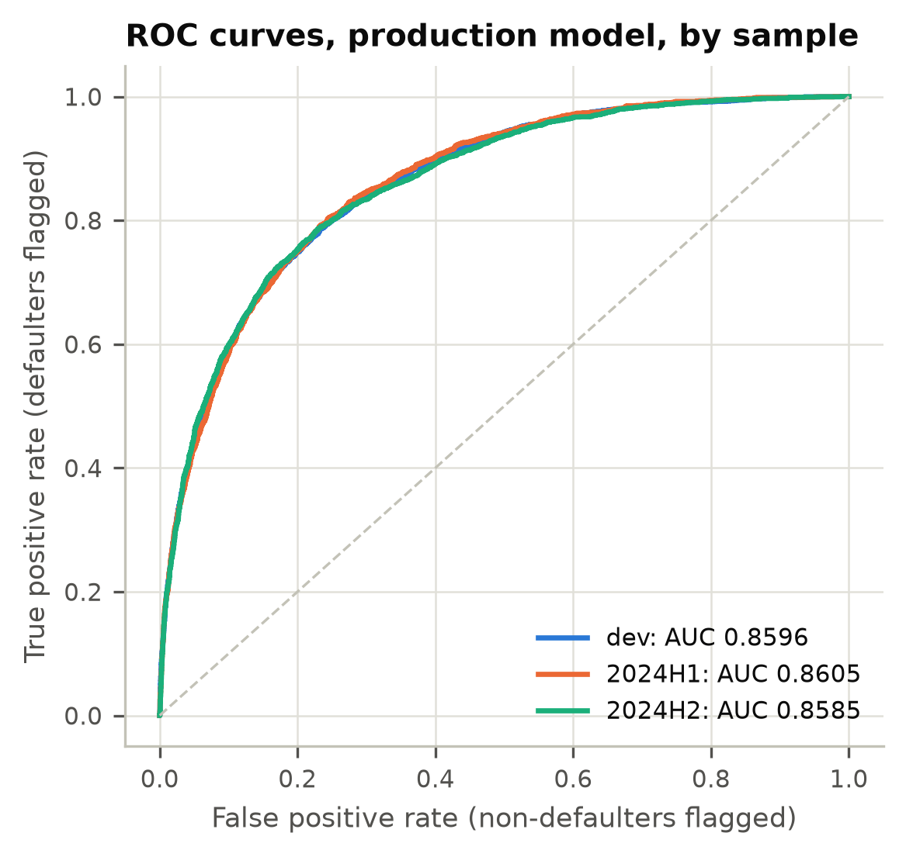{width=52%}

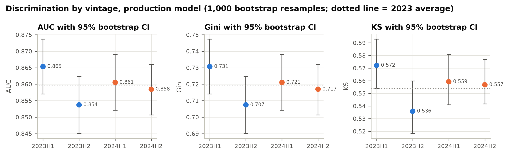{width=100%}

### 5.2 Calibration

**Table 5. Calibration tests**

| Sample | Observed DR | Mean PD | O/P | CITL p | Spiegelhalter z (p) | HL stat (p, 8 df) | Slope | Intercept | ECE |
| :--- | ---: | ---: | ---: | ---: | ---: | ---: | ---: | ---: | ---: |
| dev | 13.82% | 13.88% | 0.996 | 0.730 | -0.52 (0.606) | 10.37 (0.240) | 0.986 | -0.025 | 0.0042 |
| 2024H1 | 14.36% | 14.19% | 1.012 | 0.491 | 0.56 (0.576) | 4.35 (0.824) | 0.988 | 0.005 | 0.0035 |
| 2024H2 | 22.18% | 22.31% | 0.994 | 0.678 | -1.63 (0.103) | 13.31 (0.102) | 1.011 | -0.002 | 0.0096 |

Aggregate calibration is strong on all three samples. No test rejects at 5%. The tests were calibration-in-the-large, Spiegelhalter, Hosmer-Lemeshow and the recalibration slope. HL p-values are shown with g − 2 = 8 degrees of freedom. On the OOT samples the stricter g = 10 convention gives larger p-values: 0.930 and 0.207. Calibration slopes of 0.986 to 1.011 show no over-fitting.

On 2024H2 the expected calibration error rose to 0.0096, 2.3 times its development value. 1 of 10 deciles fell outside their 95% Jeffreys interval: decile 6: predicted 15.9% vs observed 13.6% [11.7%, 15.6%]. Both are over-predicted, which is the conservative direction. This is an early drift signal (F-08), not a calibration failure.

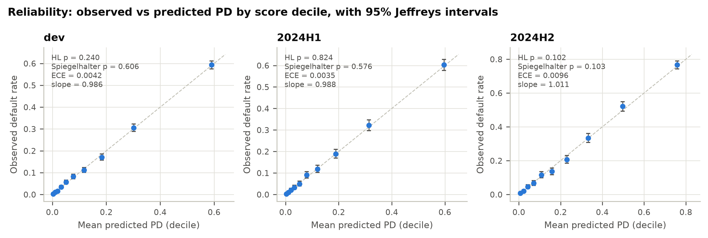{width=100%}

### 5.3 Grade-level backtesting

The validator built an 8-grade master scale with equal-population grades on development PD. The upper bounds were 0.86%, 1.93%, 3.62%, 6.25%, 10.50%, 18.12%, 34.01%. In each grade, observed defaults were tested against the grade's mean PD with a one-sided Jeffreys test for under-estimation (green p ≥ 0.05, amber 0.01 to 0.05, red p < 0.01). An exact binomial test was run as a cross-check.

**Table 6. Grade-level backtest, out-of-time vintages**

| Grade | PD upper bound | 2024H1 n | 2024H1 PD / DR | 2024H1 Jeffreys p | 2024H1 light | 2024H2 n | 2024H2 PD / DR | 2024H2 Jeffreys p | 2024H2 light |
| :--- | ---: | ---: | ---: | ---: | ---: | ---: | ---: | ---: | ---: |
| 1 | 0.86% | 1,754 | 0.43% / 0.34% | 0.695 | Green | 659 | 0.47% / 0.46% | 0.476 | Green |
| 2 | 1.93% | 1,671 | 1.35% / 1.14% | 0.768 | Green | 877 | 1.35% / 1.14% | 0.697 | Green |
| 3 | 3.62% | 1,719 | 2.70% / 2.56% | 0.637 | Green | 1,101 | 2.75% / 2.45% | 0.721 | Green |
| 4 | 6.25% | 1,794 | 4.86% / 4.74% | 0.586 | Green | 1,231 | 4.82% / 4.39% | 0.760 | Green |
| 5 | 10.50% | 1,729 | 8.20% / 8.79% | 0.185 | Green | 1,465 | 8.24% / 8.94% | 0.163 | Green |
| 6 | 18.12% | 1,757 | 13.88% / 14.23% | 0.333 | Green | 1,702 | 14.01% / 12.98% | 0.890 | Green |
| 7 | 34.01% | 1,743 | 25.28% / 26.33% | 0.157 | Green | 2,066 | 25.20% / 23.72% | 0.940 | Green |
| 8 | 100% | 1,833 | 54.38% / 54.34% | 0.516 | Green | 2,899 | 58.37% / 59.50% | 0.109 | Green |

All 16 OOT grade tests were green (0 red, 0 amber). On development, 1 grade was amber: grade 4 (predicted 4.83%, observed 5.46%, Jeffreys p = 0.043). It was green on both OOT vintages.

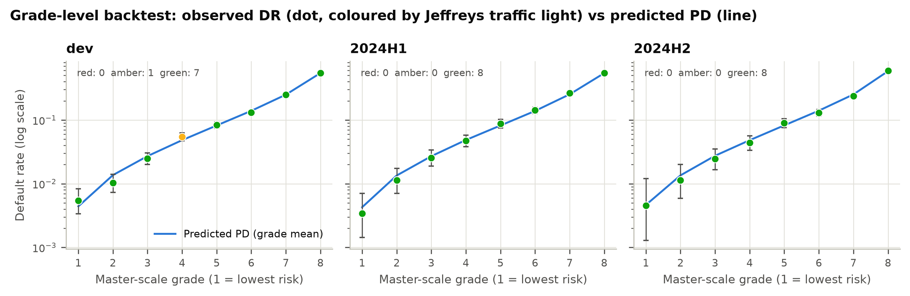{width=100%}

### 5.4 Segment calibration

Grade-level and aggregate tests can pass even when one segment is wrong, because errors in different segments offset. The validator therefore tested calibration within business segments (Table 7, Figure 10).

**Table 7. Observed/predicted by segment, out-of-time vintages (production vs enhanced challenger)**

| Sample | Segment | Loans | Share | Observed DR | Production PD | Prod. O/P | Challenger O/P | Significant (1%) |
| :--- | ---: | ---: | ---: | ---: | ---: | ---: | ---: | ---: |
| 2024H1 | All loans | 14,000 | 100.0% | 14.4% | 14.2% | 1.01 | 1.02 | - |
| 2024H1 | Income missing | 1,429 | 10.2% | 34.8% | 19.9% | 1.75 | 1.01 | Under-prediction |
| 2024H1 | Income reported | 12,571 | 89.8% | 12.0% | 13.5% | 0.89 | 1.02 | Over-prediction |
| 2024H1 | DTI <= 0.44 | 10,808 | 77.2% | 11.5% | 11.9% | 0.96 | 0.99 | - |
| 2024H1 | DTI > 0.44 | 3,187 | 22.8% | 24.2% | 21.8% | 1.11 | 1.08 | Under-prediction |
| 2024H1 | DTI > 0.54 | 1,404 | 10.0% | 31.2% | 25.1% | 1.24 | 1.08 | Under-prediction |
| 2024H1 | FICO < 640 | 1,839 | 13.1% | 47.7% | 46.7% | 1.02 | 1.03 | - |
| 2024H1 | Utilization > 0.60 | 1,192 | 8.5% | 21.6% | 21.9% | 0.99 | 1.01 | - |
| 2024H1 | Broker channel | 2,117 | 15.1% | 16.2% | 16.5% | 0.98 | 0.98 | - |
| 2024H2 | All loans | 12,000 | 100.0% | 22.2% | 22.3% | 0.99 | 1.00 | - |
| 2024H2 | Income missing | 1,415 | 11.8% | 45.0% | 29.3% | 1.53 | 0.97 | Under-prediction |
| 2024H2 | Income reported | 10,585 | 88.2% | 19.1% | 21.4% | 0.89 | 1.00 | Over-prediction |
| 2024H2 | DTI <= 0.44 | 9,263 | 77.2% | 18.6% | 19.1% | 0.98 | 0.99 | - |
| 2024H2 | DTI > 0.44 | 2,734 | 22.8% | 34.2% | 33.2% | 1.03 | 1.01 | - |
| 2024H2 | DTI > 0.54 | 1,242 | 10.3% | 42.8% | 36.8% | 1.16 | 1.04 | Under-prediction |
| 2024H2 | FICO < 640 | 2,743 | 22.9% | 53.8% | 52.6% | 1.02 | 1.02 | - |
| 2024H2 | Utilization > 0.60 | 2,407 | 20.1% | 31.1% | 30.5% | 1.02 | 1.01 | - |
| 2024H2 | Broker channel | 1,783 | 14.9% | 25.2% | 26.1% | 0.97 | 0.96 | - |

Two segments fail on every sample. **Income-missing borrowers** are under-predicted by a factor of 1.73, 1.75 and 1.53. Income-reporting borrowers are over-predicted (O/P 0.87, 0.89, 0.89). The model therefore charges reporting borrowers for losses that come from non-reporting ones. **Borrowers in the top DTI decile (DTI > 0.54)** are under-predicted by 1.21, 1.24 and 1.16. The broader DTI > 0.44 segment is significant at 1% only on 2024H1 (Jeffreys p 0.0007), because over-prediction in the 0.44 to 0.54 band offsets the tail. With only two terms added, the enhanced challenger brings income-missing O/P to 0.97 to 1.01 and DTI > 0.54 O/P to 1.04 to 1.08 across the three samples. Each error therefore has a single identified cause.

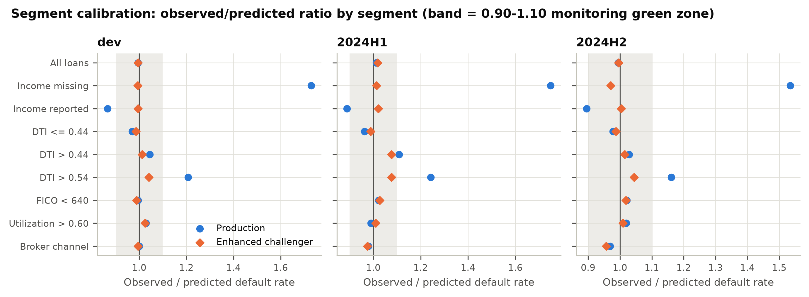{width=100%}

## 6. Benchmarking

SR 26-2 lists benchmarking as a practical assessment alternative under conceptual soundness. The validator fit four challengers on the developer's training split. The **enhanced logit** is the production recipe plus a missing-income indicator and a DTI hinge at the data-selected knot (0.44); it is the minimal fix for F-01 and F-02. The **GBM** is unconstrained gradient boosting on the nine production inputs. The **monotone GBM** is the same model with monotonicity constraints. The **logit without region_risk** is the LDA candidate. Each challenger was compared with production on the same loans using the paired DeLong test.

**Table 8. Challenger comparison (DeLong)**

| Sample | Challenger | Production AUC | Challenger AUC | Difference [95% CI] | DeLong z | p-value |
| :--- | ---: | ---: | ---: | ---: | ---: | ---: |
| dev_test | Enhanced logit | 0.8513 | 0.8672 | +0.0160 [+0.0115, +0.0204] | 7.01 | < 0.0001 |
| dev_test | GBM | 0.8513 | 0.8604 | +0.0091 [+0.0041, +0.0140] | 3.59 | 0.0003 |
| dev_test | GBM (monotone) | 0.8513 | 0.8626 | +0.0113 [+0.0066, +0.0161] | 4.66 | < 0.0001 |
| dev_test | Logit w/o region_risk | 0.8513 | 0.8506 | -0.0007 [-0.0018, +0.0005] | -1.17 | 0.241 |
| 2024H1 | Enhanced logit | 0.8605 | 0.8739 | +0.0134 [+0.0102, +0.0166] | 8.22 | < 0.0001 |
| 2024H1 | GBM | 0.8605 | 0.8661 | +0.0055 [+0.0018, +0.0092] | 2.94 | 0.003 |
| 2024H1 | GBM (monotone) | 0.8605 | 0.8678 | +0.0072 [+0.0036, +0.0108] | 3.96 | < 0.0001 |
| 2024H1 | Logit w/o region_risk | 0.8605 | 0.8602 | -0.0003 [-0.0011, +0.0005] | -0.78 | 0.435 |
| 2024H2 | Enhanced logit | 0.8585 | 0.8705 | +0.0120 [+0.0090, +0.0150] | 7.81 | < 0.0001 |
| 2024H2 | GBM | 0.8585 | 0.8635 | +0.0051 [+0.0016, +0.0085] | 2.89 | 0.004 |
| 2024H2 | GBM (monotone) | 0.8585 | 0.8649 | +0.0064 [+0.0031, +0.0097] | 3.79 | 0.0002 |
| 2024H2 | Logit w/o region_risk | 0.8585 | 0.8575 | -0.0009 [-0.0017, -0.0001] | -2.29 | 0.022 |

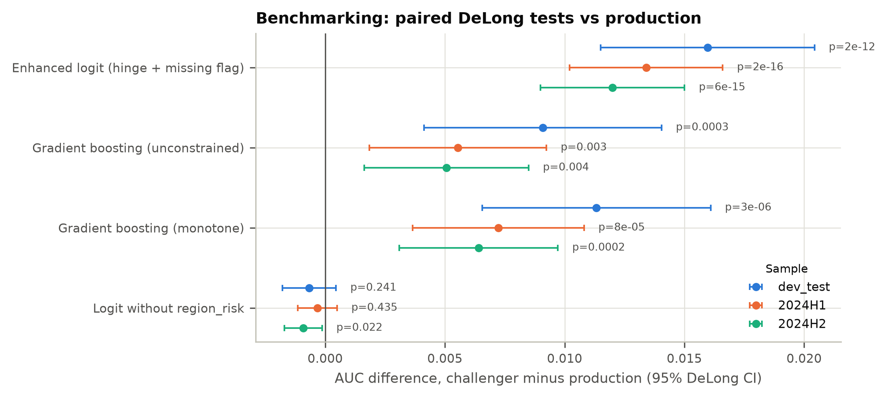{width=90%}

The enhanced logit beats production on every sample: +0.0160 (dev test), +0.0134 (2024H1) and +0.0120 (2024H2), all p < 0.0001. The unconstrained GBM gains less: +0.0055 (p 0.003) and +0.0051 (p 0.004). The two-term logit also beats the GBM by 0.0070 AUC on 2024H2. The evidence therefore points to a **specification gap, not a methodology gap**. The production model leaves signal unused because of two named design choices, not because logistic regression is too simple. A switch to machine learning is not warranted. The fix is a re-specified logistic model.

## 7. Sensitivity and stress testing

### 7.1 Input sensitivity

**Table 9. One-at-a-time sensitivity and Sobol indices (development, clean rows; base mean PD 13.85%)**

| Rank | Input | 1 SD | d mean PD per SD (pp) | Mean PD at -1 SD | Mean PD at +1 SD | Sobol S1 [95% CI] | Sobol ST |
| :--- | ---: | ---: | ---: | ---: | ---: | ---: | ---: |
| 1 | fico | 57.29 | -13.56 | 32.14% | 4.59% | 0.702 [0.669, 0.733] | 0.814 |
| 2 | dti | 0.1597 | +4.87 | 9.58% | 19.34% | 0.082 [0.072, 0.092] | 0.130 |
| 3 | utilization | 0.1782 | +3.67 | 10.52% | 17.87% | 0.044 [0.036, 0.051] | 0.077 |
| 4 | channel_broker | binary | +3.43 | 13.31% | 16.74% | 0.008 [0.005, 0.010] | 0.008 |
| 5 | delinq_24m | 0.5009 | +2.26 | 11.71% | 16.25% | 0.020 [0.016, 0.024] | 0.032 |
| 6 | inquiries_6m | 1.096 | +2.14 | 11.83% | 16.11% | 0.016 [0.012, 0.020] | 0.027 |
| 7 | employment_years | 4.215 | -1.44 | 15.35% | 12.46% | 0.006 [0.004, 0.009] | 0.011 |
| 8 | region_risk | 0.2521 | +1.11 | 12.77% | 14.99% | 0.005 [0.003, 0.007] | 0.007 |
| 9 | income_log | 0.4231 | -0.20 | 14.05% | 13.64% | 0.000 [-0.000, 0.001] | 0.000 |

The model responds to its inputs in the expected direction and in plausible proportion. FICO dominates. A ±1 SD move takes mean PD from 13.85% to 4.59% or 32.14%. FICO also explains 0.702 of PD variance on its own (first-order Sobol index) and 0.814 including interactions. DTI (S1 0.082) and utilization (S1 0.044) follow. First-order indices sum to 0.882. The remainder is interaction created by the logistic link, which is expected. `income_log` has almost no influence (total index 0.0002), consistent with F-07.

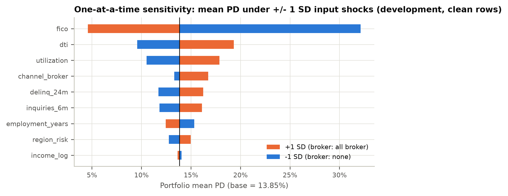{width=85%}

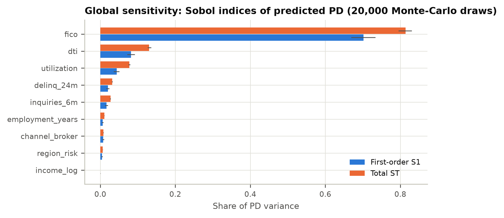{width=85%}

A combined stress scenario (FICO −30, utilization +0.10, inquiries +1) raised the mean PD to 28.21%, an increase of 103.2%. The response is monotone and has no discontinuities.

### 7.2 Parameter uncertainty

**Table 10. Coefficient perturbation at the fixed cut-off (PD 14.56%)**

| Parameter | Shift | Naive: approval change (pp) | Naive: decisions flipped | Covariance-consistent: approval change (pp) | Covariance-consistent: decisions flipped |
| :--- | ---: | ---: | ---: | ---: | ---: |
| intercept | +1 SE | -15.72 | 15.72% | +0.00 | 0.40% |
| intercept | -1 SE | +12.81 | 12.81% | -0.03 | 0.38% |
| fico | +1 SE | -7.70 | 7.70% | -0.19 | 0.21% |
| fico | -1 SE | +6.87 | 6.87% | +0.21 | 0.23% |
| dti | +1 SE | -1.02 | 1.02% | +0.07 | 0.35% |
| dti | -1 SE | +1.09 | 1.09% | -0.10 | 0.42% |
| utilization | +1 SE | -0.93 | 0.93% | +0.10 | 0.43% |
| utilization | -1 SE | +0.96 | 0.96% | -0.04 | 0.36% |
| income_log | +1 SE | -13.59 | 13.59% | +0.02 | 0.39% |
| income_log | -1 SE | +11.33 | 11.33% | -0.08 | 0.43% |
| region_risk | +1 SE | -0.90 | 0.90% | +0.06 | 0.46% |
| region_risk | -1 SE | +0.98 | 0.98% | -0.03 | 0.47% |

Shifting one coefficient by 1 SE while holding the others fixed (the naive test) suggests the model is fragile. On this test, 1 SE on the intercept flips 15.7% of decisions, and 1 SE on `income_log` flips 13.6%. That result is an artifact of uncentred inputs: the naive test produces coefficient combinations the data rule out. With the other coefficients moved by their conditional expectation (the covariance-consistent test), no single 1 SE shift flips more than 0.47% of decisions. None moves the approval rate by more than 0.21 pp. A joint draw of all coefficients from their sampling distribution (2,000 draws) gives a 90% range for the approval rate of 69.2% to 70.9% and for mean PD of 13.52% to 14.20%. In the median draw, 1.11% of decisions flip. **Estimation error is not a material source of model risk.**

### 7.3 Missing-income counterfactual

**Table 11. Income-missing borrowers: observed vs predicted**

| Sample | Income-missing loans | Observed DR | Production PD | Production O/P | PD with fill at p10 / p90 | Challenger PD (O/P) | Excess defaults |
| :--- | ---: | ---: | ---: | ---: | ---: | ---: | ---: |
| dev | 3,002 (10.7%) | 33.7% | 19.5% | 1.73 | 19.8% / 19.1% | 33.9% (0.99) | 426 |
| 2024H1 | 1,429 (10.2%) | 34.8% | 19.9% | 1.75 | 20.3% / 19.6% | 34.4% (1.01) | 213 |
| 2024H2 | 1,415 (11.8%) | 45.0% | 29.3% | 1.53 | 29.8% / 28.9% | 46.4% (0.97) | 222 |

Changing the imputation value does not fix F-01. Filling missing income at the 10th or 90th percentile moves the development PD for these borrowers only between 19.8% and 19.1%, because `income_log` has almost no weight. The gap requires a missing-value indicator. In the challenger, that indicator has a coefficient of 1.37 (odds ratio 3.92). It closes the gap on every sample. Without the fix, the model under-predicted defaults among income-missing borrowers by 426 (development), 213 (2024H1) and 222 (2024H2).

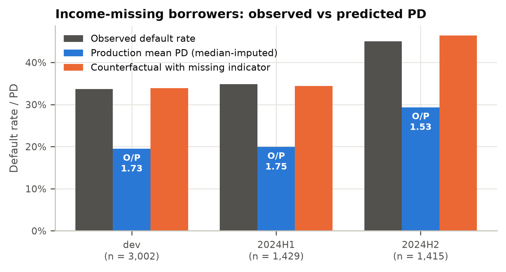{width=78%}

## 8. Stability and ongoing monitoring

### 8.1 Population stability

**Table 12. Score PSI and characteristic CSI vs development**

| Variable | 2024H1 | 2024H2 |
| :--- | ---: | ---: |
| Score (PD) | 0.0014 | 0.1936 |
| fico | 0.0011 | 0.1498 |
| dti | 0.0004 | 0.0012 |
| utilization | 0.0014 | 0.1785 |
| income_log | 0.0007 | 0.0015 |
| inquiries_6m | 0.0004 | 0.0005 |
| delinq_24m | 0.0004 | 0.0000 |
| employment_years | 0.0006 | 0.0012 |
| region_risk | 0.0008 | 0.0006 |
| channel_broker (abs. share change) | 0.0024 | 0.0051 |

2024H1 is stable (score PSI 0.0014). 2024H2 is amber (score PSI 0.1936). The shift is confined to FICO (CSI 0.1498) and utilization (CSI 0.1785). Every other input has a CSI below 0.01.

At the grade level, the share of loans in the riskiest grade rose from 12.5% to 24.2%, and the share in the safest grade fell from 12.5% to 5.5% (grade PSI 0.194). At the fixed production cut-off, the approval rate fell from 70.0% to 53.0%.

The shift is a change in borrower mix along variables the model already uses (covariate shift), not a change in how those variables relate to default (concept drift). Outcomes analysis confirms this: 2024H2 calibration and discrimination held. The shift is therefore not a defect of the model. It is still a risk that must be monitored, because the next shift may fall outside the development range (F-03).

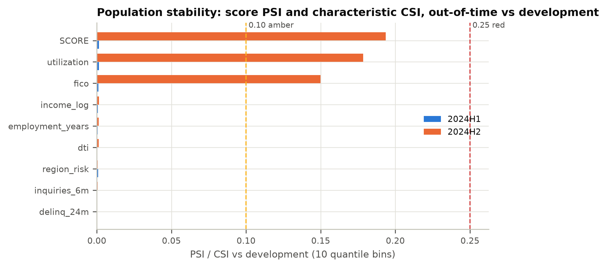{width=85%}

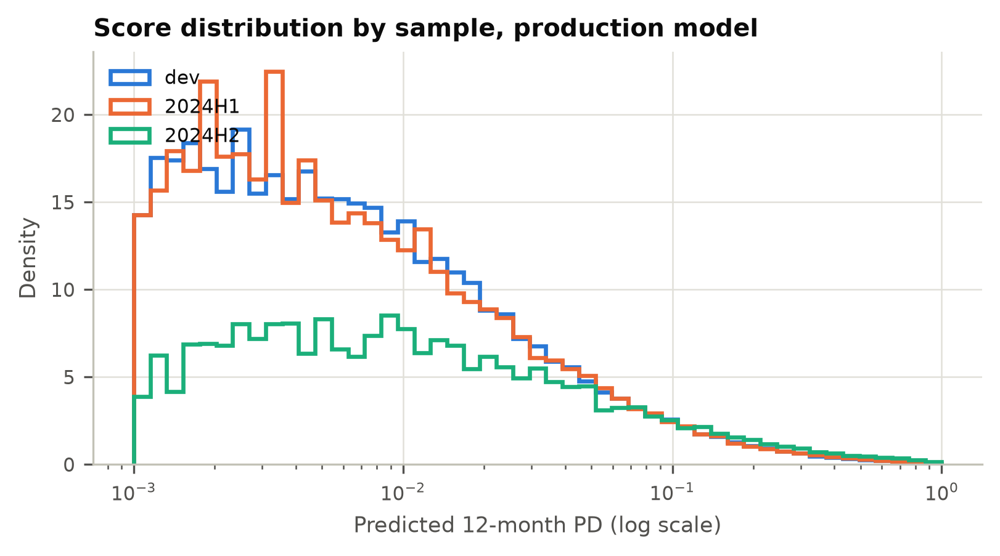{width=78%}

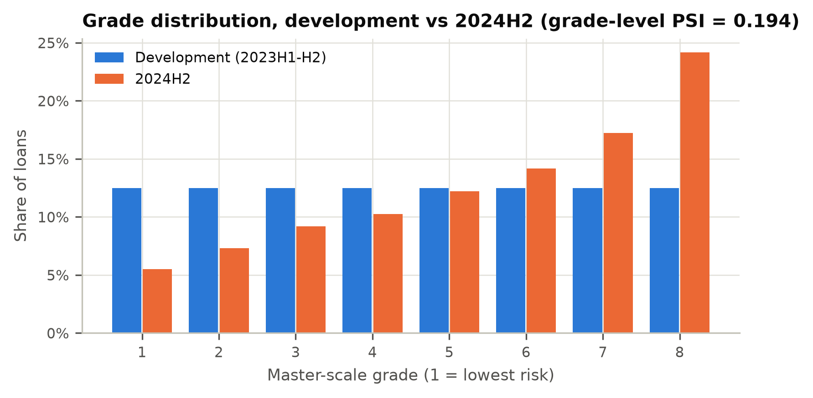{width=78%}

A true obligor-level grade migration matrix cannot be estimated from origination data, because each loan is observed only once. The validator reports the grade-mix migration above instead. It also reports a 2024H2 reclassification matrix comparing the production grade with the grade the enhanced challenger would assign (Table 13). The remediation would change the grade of 34.7% of 2024H2 loans. 96.1% of loans stay within one grade. 464 loans move two or more grades. Of these, 99.8% are income-missing borrowers and 100% move to a riskier grade.

**Table 13. 2024H2 reclassification: production grade (rows) vs enhanced-challenger grade (columns), loan counts**

| Production grade | 1 | 2 | 3 | 4 | 5 | 6 | 7 | 8 |
| :--- | ---: | ---: | ---: | ---: | ---: | ---: | ---: | ---: |
| 1 | 590 | 48 | 21 | 0 | 0 | 0 | 0 | 0 |
| 2 | 200 | 593 | 36 | 46 | 2 | 0 | 0 | 0 |
| 3 | 0 | 314 | 652 | 39 | 79 | 17 | 0 | 0 |
| 4 | 0 | 0 | 436 | 647 | 42 | 94 | 12 | 0 |
| 5 | 0 | 0 | 0 | 578 | 709 | 67 | 111 | 0 |
| 6 | 0 | 0 | 0 | 0 | 591 | 887 | 142 | 82 |
| 7 | 0 | 0 | 0 | 0 | 0 | 529 | 1248 | 289 |
| 8 | 0 | 0 | 0 | 0 | 0 | 0 | 393 | 2506 |

### 8.2 Proposed monitoring plan

The developer's plan of "annual review" has no KPIs, thresholds or escalation. That does not meet the ongoing-monitoring component of SR 26-2. That component asks whether the model still performs as expected as products, data and market conditions change, and it notes that a model which no longer does so "may warrant overlays, adjustment, or redevelopment". The bank's policy requires such monitoring to be threshold-based for a Tier 1 model. The validator specified a 13-KPI plan with pre-set thresholds, owners and escalation. It is delivered in machine-readable form at `outputs/monitoring_thresholds.json` (Table 14). Two consecutive amber results count as red. The segment KPIs for income-missing and high-DTI loans stay in force until F-01 and F-02 are closed.

**Table 14. Monitoring KPIs and thresholds**

| KPI | Green | Amber | Red | Frequency | Owner |
| :--- | :--- | :--- | :--- | :--- | :--- |
| Score PSI (dev vs current quarter applications) | < 0.10 | 0.10 - 0.25 | >= 0.25 | Monthly | Retail Credit Analytics (model owner) |
| Characteristic stability (CSI), each input | < 0.10 | 0.10 - 0.25 | >= 0.25 | Monthly | Retail Credit Analytics |
| AUC decay vs development | < 0.03 | 0.03 - 0.05 | >= 0.05 or lower 95% CI below 0.80 | Quarterly (12-month performance window) | Retail Credit Analytics |
| KS decay vs development | < 0.04 | 0.04 - 0.07 | >= 0.07 | Quarterly | Retail Credit Analytics |
| Calibration ratio (observed DR / mean PD), portfolio | 0.90 - 1.10 | 0.80 - 0.90 or 1.10 - 1.20 | < 0.80 or > 1.20 | Quarterly | Retail Credit Analytics |
| Calibration ratio, income-missing segment | 0.90 - 1.10 | 0.80 - 0.90 or 1.10 - 1.20 | < 0.80 or > 1.20 | Quarterly | Retail Credit Analytics |
| Calibration ratio, DTI > 0.44 segment (data-selected knot) | 0.90 - 1.10 | 0.80 - 0.90 or 1.10 - 1.20 | < 0.80 or > 1.20 | Quarterly | Retail Credit Analytics |
| Grade-level Jeffreys test (one-sided, under-estimation) | 0 red, <= 1 amber | 1 red or >= 2 amber | >= 2 red | Quarterly | Retail Credit Analytics |
| Approval rate by segment (channel, income-missing, DTI band) | < 5 pp | 5 - 10 pp | >= 10 pp | Monthly | Credit Policy |
| Adverse impact ratio (proxy-based, BISG or equivalent) | >= 0.90 | 0.80 - 0.90 | < 0.80 | Quarterly | Fair Lending Compliance |
| Data quality: range-violation rate (FICO outside 300-850, DTI outside 0-1) | < 0.01% | 0.01% - 0.10% | >= 0.10% | Monthly | Data Management / Model owner |
| Data quality: income missing rate | within +/- 2 pp of baseline | 2 - 5 pp | > 5 pp | Monthly | Data Management / Model owner |
| Override rate (manual decisions against model) | < 5% | 5% - 10% | >= 10% | Monthly | Credit Policy |

## 9. Fair lending and disparate impact

The portfolio carries a simulated protected-class flag (group B; group A is the control group). It is used only for testing, as a stand-in for the proxy-based methods (e.g., BISG) that a lender would use in practice. All metrics are measured at the fixed production cut-off.

**Table 15. Group outcome metrics, production vs model without `region_risk`**

| Sample | Model | Approval A / B | AIR | DP diff (pp) | EO diff (pp) | FPR gap (pp) | O/P A / B | AUC |
| :--- | ---: | ---: | ---: | ---: | ---: | ---: | ---: | ---: |
| dev | Production | 71.0% / 67.8% | 0.954 | -3.26 | -2.55 | -2.02 | 0.991 / 1.005 | 0.8596 |
| dev | Without region_risk | 70.5% / 69.0% | 0.978 | -1.52 | -0.77 | -0.52 | 0.971 / 1.047 | 0.8589 |
| 2024H1 | Production | 70.6% / 67.5% | 0.956 | -3.10 | -2.02 | -3.53 | 1.008 / 1.021 | 0.8605 |
| 2024H1 | Without region_risk | 69.8% / 68.8% | 0.985 | -1.02 | -0.09 | -0.65 | 0.987 / 1.063 | 0.8602 |
| 2024H2 | Production | 54.0% / 50.7% | 0.939 | -3.31 | -2.18 | -1.95 | 0.988 / 1.007 | 0.8585 |
| 2024H2 | Without region_risk | 52.8% / 51.9% | 0.981 | -0.98 | +0.39 | -0.37 | 0.971 / 1.041 | 0.8575 |

**Disparate-impact testing.** The production model approved group B less often than group A on every sample. AIR was 0.954 (development), 0.956 (2024H1) and 0.939 (2024H2). On 2024H2 the demographic-parity difference (approval rate, B minus A) was -3.31 pp. The equal-opportunity difference (the same gap among borrowers who did not default) was -2.18 pp, and the FPR gap (among borrowers who defaulted) was -1.95 pp. Every AIR is above the four-fifths threshold (0.80) and the bank's internal review trigger (0.90). The model therefore does not breach a disparate-impact screen.

**Differential validity.** The model is equally accurate for both groups. Within-group AUC on 2024H2 was 0.8600 (A) and 0.8545 (B). O/P was 0.988 (A) and 1.007 (B) (Figure 19).

**Proxy analysis.** `region_risk` is a partial proxy for group membership. Its correlation with group B is 0.348. On its own it predicts group membership with an AUC of 0.711. Mean `region_risk` is 0.409 in group A and 0.597 in group B. Two likelihood-ratio tests on development data separate proxy effect from risk signal. First, `region_risk` stays predictive after controlling for group membership (LR = 31.25, p = 2.3e-08). Its average marginal effect is 4.17 pp of PD per unit (SE 0.75) with group in the model, against 4.31 pp without it, an attenuation of only 3.4%. Second, group membership adds nothing once the nine inputs are in the model (LR = 0.289, p = 0.591). Taken together, `region_risk` carries genuine default signal and is not mainly standing in for group membership. The raw default-rate gap (A 13.4%, B 14.8%) is fully explained by the model's inputs.

**Less discriminatory alternative.** Removing `region_risk` raises AIR to 0.978, 0.985 and 0.981. It costs 0.0007, 0.0003 and 0.0009 AUC on the dev test, 2024H1 and 2024H2 samples (DeLong p 0.241, 0.435, 0.022). The alternative has a cost the AUC change does not show: group B becomes under-predicted (O/P 1.041 on 2024H2, against 1.007 for production). That shortfall is mispriced risk.

**Regulatory assessment.** Under ECOA and Regulation B, a facially neutral variable that disproportionately disadvantages a protected class must serve a legitimate business need that a less discriminatory alternative cannot meet reasonably well. The evidence here supports business justification but also identifies a viable LDA at small cost. The trade-off is a fair-lending policy decision, not a modelling decision. The developer did not document any analysis of it. The regulatory posture on disparate-impact enforcement has changed in recent years, and state law and private litigation risk remain. The bank's Fair Lending Policy still requires the analysis. The validator rates this finding Medium (F-04): the evidence shows no current breach, but the control gap is real.

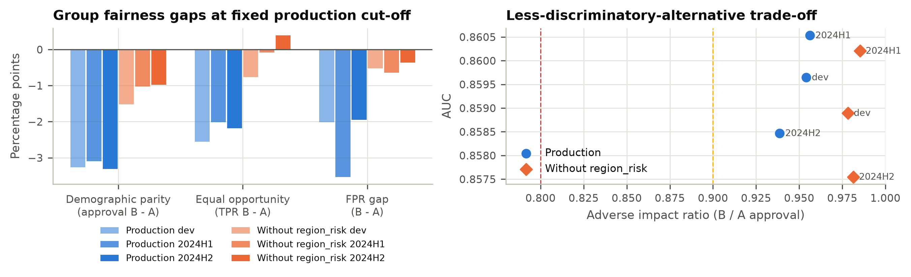{width=100%}

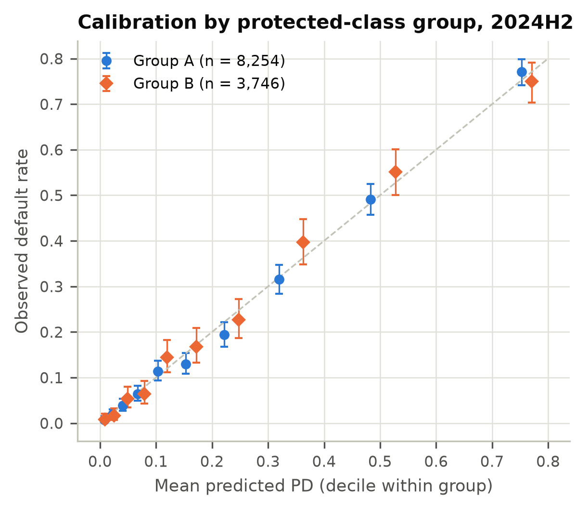{width=52%}

## 10. Validating an ML challenger: what would change

The GBM challenger is not proposed for production (Section 6). It does, however, show how the same framework applies to a machine-learning credit model, and why such a model would require more evidence before approval. SR 26-2 covers non-generative, non-agentic AI/ML models such as this GBM. Generative and agentic AI fall outside it and are governed under the organization's broader risk management practices. This section is therefore within the scope of the guidance.

**Explanation stability.** The GBM and the production recipe were each refit on 20 bootstrap resamples. Permutation importance (AUC drop) was then measured on the fixed development test split (Figure 20). The logistic recipe kept the same top-three inputs in 100% of resamples, and its rankings had a mean pairwise Spearman correlation of 0.972. The GBM kept the same top three in only 55% (Spearman 0.956, minimum 0.900). Low-importance inputs were unstable: the GBM's coefficient of variation was 0.70 for `employment_years` and 0.55 for `region_risk`. Adverse-action reason codes built from such importances would change between model refreshes for the same applicant.

The GBM also gives `income_log` a mean importance of 0.0176 (mean rank 3.55), against 0.0002 (rank 9) for the logit. Trees can isolate the exact imputed value $60,294 and so recover the missing-income flag. Part of the GBM's advantage over production is therefore F-01 rediscovered by accident. An ML validation must look for this kind of hidden leakage of data handling into the model.

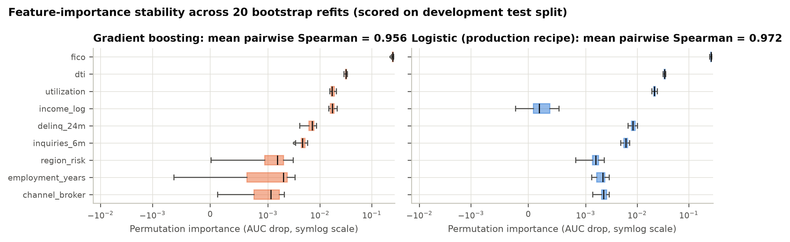{width=100%}

**Monotonicity.** On the unconstrained GBM, partial-dependence curves reversed direction 4/24 times for DTI (largest reversal 1.01 pp) and 3/24 times for utilization (0.41 pp). At the individual level, 43% (DTI) and 51% (utilization) of applicant ICE curves contained a reversal larger than 0.5 pp. Even for FICO, where the average curve was monotone, 16% of ICE curves reversed. A model in which higher debt lowers predicted risk for some applicants cannot support a credible adverse-action reason. The monotone-constrained GBM removed every reversal, and it scored *higher* out of time than the unconstrained version (2024H2 AUC 0.8649 vs 0.8635).

**Table 16. Monotonicity checks (development test split; 25-point grid; 1,000 ICE curves)**

| Input | Model | Expected | PD-curve reversals | Largest reversal (pp) | ICE curves with reversal > 0.5 pp |
| :--- | ---: | ---: | ---: | ---: | ---: |
| fico | production | decreasing | 0/24 | 0.00 | 0.0% |
| fico | gbm | decreasing | 0/24 | 0.00 | 15.9% |
| fico | gbm_monotone | decreasing | 0/24 | 0.00 | 0.0% |
| dti | production | increasing | 0/24 | 0.00 | 0.0% |
| dti | gbm | increasing | 4/24 | 1.01 | 43.1% |
| dti | gbm_monotone | increasing | 0/24 | 0.00 | 0.0% |
| utilization | production | increasing | 0/24 | 0.00 | 0.0% |
| utilization | gbm | increasing | 3/24 | 0.41 | 51.3% |
| utilization | gbm_monotone | increasing | 0/24 | 0.00 | 0.0% |

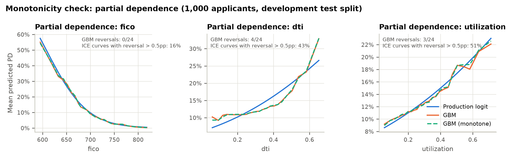{width=100%}

**Additional requirements for an ML model.** An ML credit model would need four things beyond what this report tests:

- Reason-code generation that is accurate for each individual applicant. CFPB Circulars 2022-03 and 2023-03 confirm that the adverse-action notice requirements of ECOA/Regulation B apply in full to complex models.
- Monotonic constraints on all policy-relevant inputs.
- Hyperparameter governance, with the tuning protocol and seeds documented and reproducible.
- An explicit test of whether data-handling artifacts are learned as signal.

## 11. Findings register

**Severity definitions.** *High:* a deficiency that can cause material financial loss, a mis-stated risk estimate or a regulatory breach. It requires a use restriction or compensating control until remediated (target ≤ 6 months). *Medium:* a weakness that does not currently produce a material error but could do so, or a significant gap in a required control or documentation (target ≤ 6 months). *Low:* a minor weakness or improvement with limited impact (target ≤ 12 months, or next redevelopment).

| ID | Severity | Category | Description | Evidence | Root cause | Recommendation | Owner | Target date |
|:----|:------|:--------|:----------------------------------|:-------|:--------------|:-----------------|:---------|:---------|
| F-01 | **High** | Conceptual soundness / data | Income-missing borrowers (10.7% of loans) are under-predicted: O/P 1.73 (dev), 1.75 (2024H1), 1.53 (2024H2), p < 0.0001. Income-reporting borrowers are over-predicted (O/P 0.87 to 0.89). | Tables 7, 11; Figs 10, 14 | Median imputation without a missing indicator discards informative missingness. | Interim overlay (Condition 1); add a missing indicator at redevelopment. | Retail Credit Analytics | Overlay 2026-12-11; fix 2027-03-31 |
| F-02 | **High** | Conceptual soundness | Linear DTI term misses the change in slope at 0.44 (data-selected; 95% CI 0.42 to 0.47). DTI > 0.54 is under-predicted: O/P 1.21, 1.24, 1.16 (p < 0.0001). | Figs 2, 3, 10; Tables 7, 8 | Functional form not tested in development. | Re-specify DTI (hinge, spline or binned WOE); monitor the DTI > 0.44 segment KPI in the interim. | Retail Credit Analytics | 2027-03-31 |
| F-03 | Medium | Ongoing monitoring | 2024H2 score PSI 0.1936 (amber); FICO CSI 0.1498, utilization CSI 0.1785. Approval rate at the fixed cut-off fell from 70.0% to 53.0%. The plan was "annual review" with no thresholds. | Table 12; Figs 15 to 17 | No monitoring framework defined at development. | Adopt the 13-KPI plan (Table 14) with quarterly reporting. | Retail Credit Analytics | 2027-01-31 |
| F-04 | Medium | Fair lending | `region_risk` is a partial proxy (correlation 0.348). AIR 0.939 on 2024H2; an LDA reaches AIR 0.981 at AUC cost 0.0009. No fair-lending review was documented. | Table 15; Figs 18, 19 | Fair-lending review omitted from the development process. | Document business justification and the LDA decision; add AIR to monitoring. | Fair Lending Compliance; Retail Credit Analytics | 2027-01-31 |
| F-05 | Medium | Data / implementation | 25 range violations (FICO = 0, DTI > 1), 8 of them in training data, scored at mean PD 1.0000 and 0.937. No input edits. | Table 1; Section 3 | No input validation in pipeline or decision engine. | Add range edits with manual referral; add a DQ KPI. | Retail Credit Technology | 2026-12-31 |
| F-06 | Medium | Documentation | No assumptions, limitations, OOT test, calibration test, sensitivity analysis, variable justification or monitoring plan. | Section 4.6 | Documentation standard not applied. | Remediate to the Model Documentation Standard as part of redevelopment. | Retail Credit Analytics | 2027-03-31 |
| F-07 | Low | Conceptual soundness | `income_log` is not significant (z = -0.94, p = 0.346) and has total Sobol index 0.0002. It is retained without justification. | Tables 2, 9 | Variable selection not documented. | Re-assess at redevelopment once the missing indicator is added. | Retail Credit Analytics | 2027-03-31 |
| F-08 | Low | Outcomes | 2024H2: 1 deciles outside their 95% interval (over-predicted); ECE 0.0096 vs 0.0042 at development; HL p 0.102. No grade is red. | Table 5; Fig 8 | Early effect of population shift. | Track via the calibration KPIs; investigate if amber for two quarters. | Retail Credit Analytics | 2027-01-31 |

## 12. Limitations of this validation and conditions for use

**Limitations.**

- The data are synthetic. The effect sizes are realistic but are not estimates for any real portfolio.
- The protected-class flag is directly observed. In practice it would be inferred (e.g., BISG), which adds measurement error to every fairness metric.
- Twelve-month outcomes are observed for every vintage. In production, the latest vintage would be immature, and monitoring would rely on early-delinquency proxies.
- No economic downturn appears in the sample. The stress scenario is a sensitivity test, not a macroeconomic stress test.
- Implementation testing was limited to scoring the frozen artifact in Python. The production decision engine was not tested.
- Challenger hyperparameters were fixed, not tuned. Challenger AUCs are therefore lower bounds.

**Conditions for use** are listed in Section 1.3. MRM will track each condition in the model inventory. Closing a condition requires evidence reviewed by MRM. Failure to meet Condition 1 or 3 on time moves the rating to Restricted Use.

## Appendix A. Full Wald table

See Table 2 (Section 4.3). The coefficient covariance comes from the information matrix on the developer's 19,440 training loans. Using all 28,000 development loans would understate the standard errors by about 17%.

## Appendix B. Decile tables

**B.1 Development (28,000 loans)**

| Decile | Loans | Mean PD | Observed DR | O/P |
| :--- | ---: | ---: | ---: | ---: |
| 1 | 2,800 | 0.36% | 0.29% | 0.806 |
| 2 | 2,800 | 1.05% | 1.04% | 0.990 |
| 3 | 2,800 | 1.96% | 1.54% | 0.786 |
| 4 | 2,800 | 3.24% | 3.36% | 1.037 |
| 5 | 2,800 | 5.08% | 5.68% | 1.118 |
| 6 | 2,800 | 7.77% | 8.18% | 1.053 |
| 7 | 2,800 | 11.79% | 11.18% | 0.948 |
| 8 | 2,800 | 18.37% | 17.07% | 0.929 |
| 9 | 2,800 | 30.21% | 30.54% | 1.011 |
| 10 | 2,800 | 59.00% | 59.36% | 1.006 |

**B.2 2024H1 (14,000 loans)**

| Decile | Loans | Mean PD | Observed DR | O/P |
| :--- | ---: | ---: | ---: | ---: |
| 1 | 1,400 | 0.35% | 0.21% | 0.600 |
| 2 | 1,400 | 1.04% | 0.93% | 0.894 |
| 3 | 1,400 | 2.00% | 2.07% | 1.035 |
| 4 | 1,400 | 3.35% | 3.29% | 0.982 |
| 5 | 1,400 | 5.23% | 4.93% | 0.943 |
| 6 | 1,400 | 7.93% | 9.07% | 1.144 |
| 7 | 1,400 | 12.04% | 11.86% | 0.985 |
| 8 | 1,400 | 18.93% | 18.86% | 0.996 |
| 9 | 1,400 | 31.34% | 32.14% | 1.026 |
| 10 | 1,400 | 59.70% | 60.29% | 1.010 |

**B.3 2024H2 (12,000 loans)**

| Decile | Loans | Mean PD | Observed DR | O/P |
| :--- | ---: | ---: | ---: | ---: |
| 1 | 1,200 | 0.77% | 0.75% | 0.974 |
| 2 | 1,200 | 2.32% | 1.92% | 0.828 |
| 3 | 1,200 | 4.30% | 4.50% | 1.047 |
| 4 | 1,200 | 7.11% | 6.67% | 0.938 |
| 5 | 1,200 | 10.83% | 11.58% | 1.069 |
| 6 | 1,200 | 15.87% | 13.58% | 0.856 |
| 7 | 1,200 | 22.96% | 20.67% | 0.900 |
| 8 | 1,200 | 33.27% | 33.33% | 1.002 |
| 9 | 1,200 | 49.77% | 52.08% | 1.046 |
| 10 | 1,200 | 75.86% | 76.67% | 1.011 |

## Appendix C. PSI / CSI detail

PSI uses 10 quantile bins fixed on the development distribution, with empty bins floored at 10⁻⁶. Thresholds: < 0.10 stable, 0.10 to 0.25 amber, ≥ 0.25 red. For the binary `channel_broker`, Table 12 reports the absolute change in the broker share. Full tables: `outputs/tables/psi_csi.csv`, `outputs/tables/stability.json`.

## Appendix D. Figure index

| Figure | File | Content |
| :--- | :--- | :--- |
| Figure 1 | `outputs/figures/fig01_vintage_profile.png` | Default rate, mean FICO, mean utilization and income-missing default rate by vintage |
| Figure 2 | `outputs/figures/fig02_dti_functional_form.png` | Binned empirical log-odds vs production and challenger log-odds across DTI |
| Figure 3 | `outputs/figures/fig03_dti_knot_profile.png` | Profile log-likelihood of the enhanced specification across candidate DTI knots, with 95% interval |
| Figure 4 | `outputs/figures/fig04_fico_functional_form.png` | Binned empirical log-odds vs production and challenger log-odds across FICO |
| Figure 5 | `outputs/figures/fig05_information_value.png` | Information value of each characteristic; income shown raw (missing as its own bin) and as imputed by the model |
| Figure 6 | `outputs/figures/fig06_roc.png` | ROC curves of the production model on development and out-of-time samples |
| Figure 7 | `outputs/figures/fig07_discrimination_trend.png` | AUC, Gini and KS by vintage with 95% bootstrap confidence intervals |
| Figure 8 | `outputs/figures/fig08_reliability.png` | Reliability diagrams (deciles) with Jeffreys intervals and calibration statistics |
| Figure 9 | `outputs/figures/fig09_grade_backtest.png` | Per-grade Jeffreys backtest with traffic lights on development and out-of-time vintages |
| Figure 10 | `outputs/figures/fig10_segment_calibration.png` | Observed-to-predicted ratio by business segment, production vs enhanced challenger |
| Figure 11 | `outputs/figures/fig11_benchmark_delong.png` | AUC difference between each challenger and production with DeLong 95% CIs and p-values |
| Figure 12 | `outputs/figures/fig12_sensitivity_tornado.png` | Tornado chart of portfolio mean PD under +/- 1 SD shocks to each input |
| Figure 13 | `outputs/figures/fig13_sobol.png` | First-order and total Sobol indices of predicted PD |
| Figure 14 | `outputs/figures/fig14_missing_income.png` | Observed default rate vs production and counterfactual PD for income-missing borrowers |
| Figure 15 | `outputs/figures/fig15_psi_csi.png` | Score PSI and characteristic CSI for 2024H1 and 2024H2 against development |
| Figure 16 | `outputs/figures/fig16_score_distribution.png` | Distribution of predicted PD by sample |
| Figure 17 | `outputs/figures/fig17_grade_mix.png` | Distribution of loans across master-scale grades, development vs 2024H2 |
| Figure 18 | `outputs/figures/fig18_fairness.png` | Group fairness gaps and AUC vs adverse impact ratio, production vs model without region_risk |
| Figure 19 | `outputs/figures/fig19_calibration_by_group.png` | Reliability by simulated protected-class group, 2024H2 |
| Figure 20 | `outputs/figures/fig20_importance_stability.png` | Bootstrap distribution of permutation importance, GBM vs logistic |
| Figure 21 | `outputs/figures/fig21_monotonicity.png` | Partial-dependence curves for FICO, DTI and utilization: production, GBM and monotone GBM |

## Appendix E. Reproducibility statement

The full validation reproduces from a clean checkout with `make all`. That command regenerates the data, refits and freezes the production model, runs the validation, runs the unit tests and builds this report. Every number in this report is inserted from `outputs/` by `report/build_report.py`. Before rendering, the builder re-tests the evidence behind each finding and refuses to publish if the evidence no longer supports the register.

- **Code version:** d407623437e90ea3fead58d4a7a1d0e5bed46c73. The SHA-256 content hashes in Table E.1 identify the exact data, model artifact and validation code used.
- **Run timestamp:** 2026-11-10T04:00:07Z; Python 3.13.18; numpy 2.5.3, pandas 3.0.5, scikit-learn 1.9.1, scipy 1.18.1, matplotlib 3.11.2
- **Random seeds:** data_generation = 20261109, developer_split = 7, bootstrap_discrimination = 11, sobol = 5, coef_simulation = 9, importance_bootstrap = 21, ice_sample = 3, gbm = 0
- **Bootstrap:** 1000 resamples for discrimination CIs; 20 refits for importance stability; 2,000 coefficient draws; 20,000 Sobol base samples

**Table E.1. Content hashes of inputs and validation code**

| File | SHA-256 (first 16 hex) |
| :--- | :--- |
| `data/portfolio.csv` | a10068359ece9e11 |
| `data/make_data.py` | adc6028dbeeb862c |
| `model/pd_model_v1.pkl` | 4a4e6afa1ec4a16e |
| `model/develop_model.py` | 1ede9b4509981ecb |
| `model/developer_documentation.json` | fe0db11814e0a772 |
| `validation/tests.py` | be74780eeb3c93a3 |
| `validation/advanced.py` | bd2e1a48e76dee46 |
| `validation/stats_core.py` | f8137079dfe32f37 |
